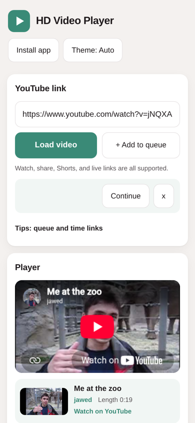
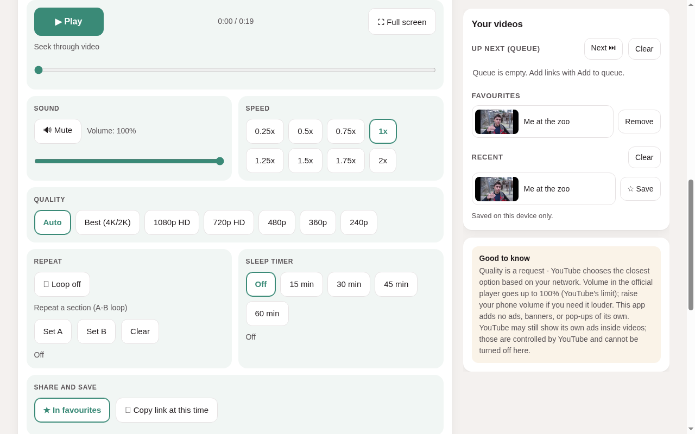
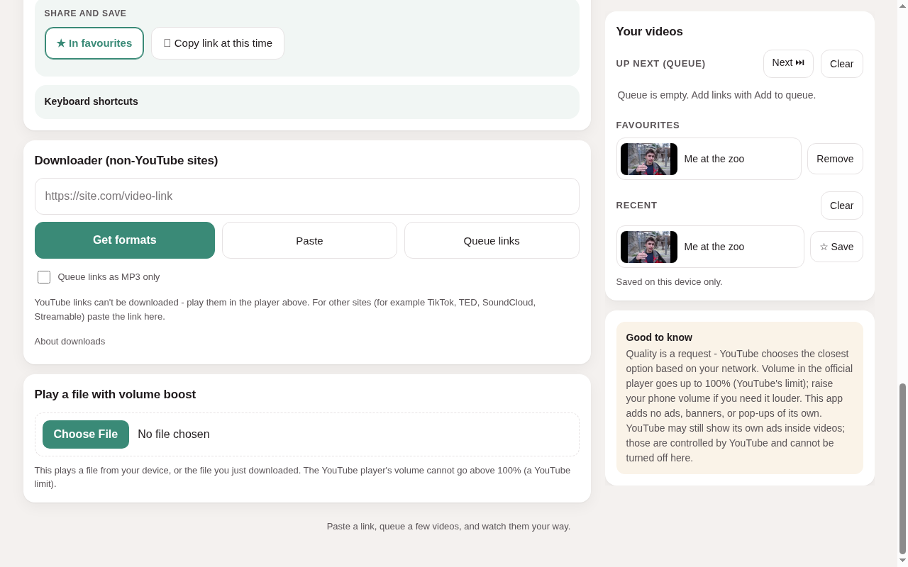
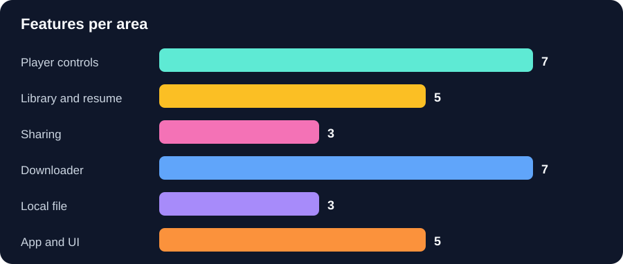
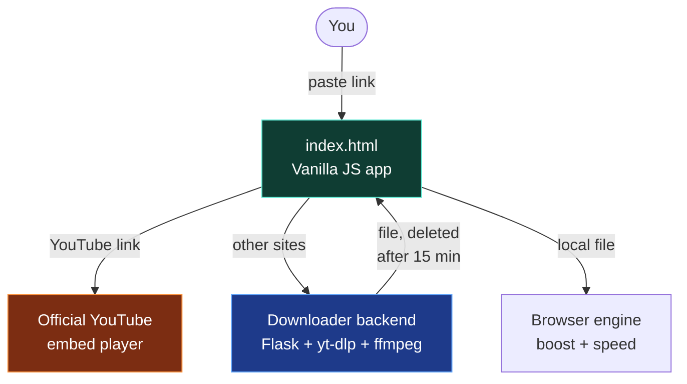
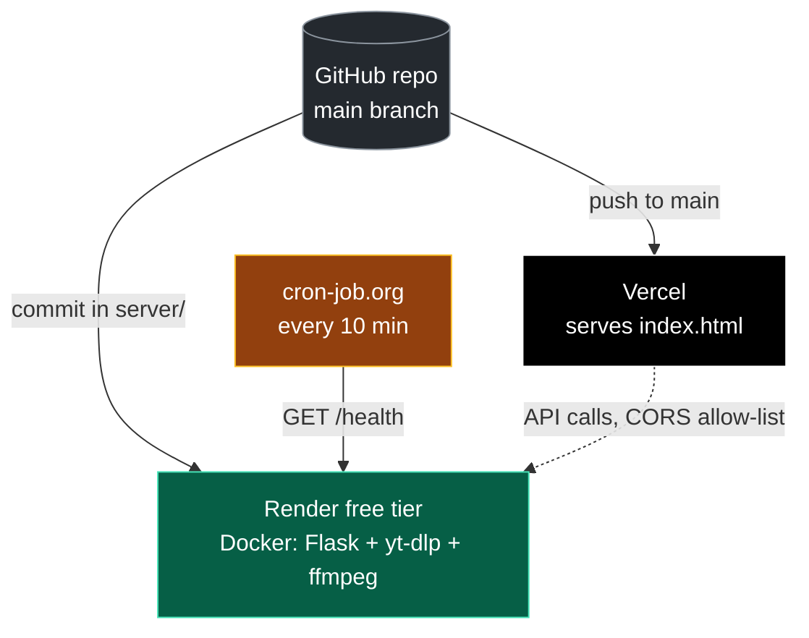
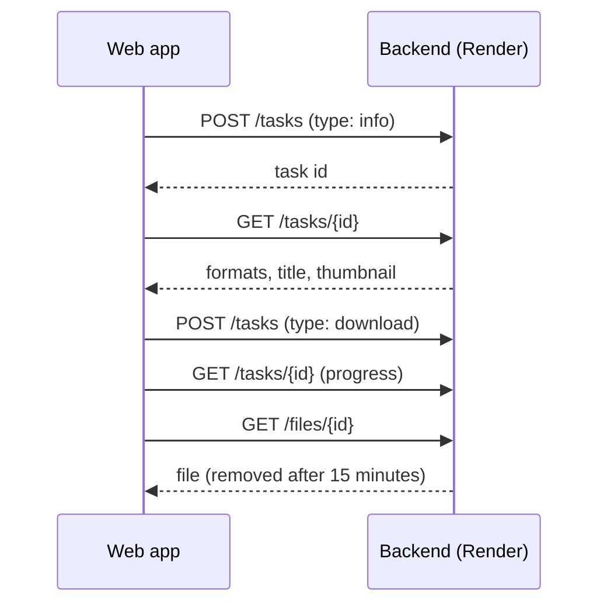

 

### [Open the live app](https://vp-player.pages.dev/)

---

## Demo

 Screen recording of the live app: paste a link, play, save, tune the controls, use the downloader and the local file player.

## Screenshots

| Desktop | Phone |
|:---:|:---:|
|  |  |

| Controls | Downloader |
|:---:|:---:|
|  |  |

## Retiming a playback cue sheet

Open a device video, open **Playback cue sheet**, then **Retime playback cues**.
This changes playback instructions, not the video file. It does not work on
YouTube embeds.

- **Shift all cues:** enter seconds to move the whole sheet. Use a negative
  value to move it earlier.
- **Align using two points:** match two original times to two desired times.
  The app stretches cue times in that proportion. Speed and volume values
  stay unchanged.
- Jump destinations stay unchanged unless **Also retime jump destinations**
  is selected. Preview shows the old and new cue times and any changed
  jump destination, to hundredth-second precision.
- **Preview timing changes** changes nothing. **Apply timing changes** applies
  the reviewed sheet as one change and disarms cues. It never seeks or plays.
  Any out-of-video result or conflicting pause/jump timestamp rejects the
  entire operation, without clamping or dropping individual cues.
- **Undo last timing change** restores the previous sheet while it is still
  the same device file and no later cue edit has been made. Undo is tab-only
  and does not rewrite a sheet already saved on the device.

Use **Save cues on this device** or **Export cue sheet** after applying changes
if you want to keep them. Opening a new file or reloading never applies timing
changes or arms cues automatically. Existing limits still apply: 40 cues per
sheet, device files only, and no automatic identification of an edited video.
All controls and review labels support English, Hindi and Gujarati.

## Features

| Area | What you get |
|---|---|
| **Player controls** | Speed presets, quality request, loop, A-B repeat, sleep timer, keyboard shortcuts, picture-in-picture |
| **Library and resume** | Queue with auto-next, favourites, recent videos, "Continue where you left off", remembered settings |
| **Sharing** | Copy a link that starts at the current time, link tricks (`?url=`, `?v=`, `?text=`, `?from=`, `?to=`) |
| **Downloader** | For non-YouTube sites: format info, quality picker, merge, MP3, trim, subtitles, multi-link queue with retry |
| **Local file** | Play a file from your device with volume boost up to 300% and speed presets |
| **App and UI** | Auto, Light and Dark theme, responsive layout for phone and laptop, installable PWA with share-target, "Waking up the free server" indicator |

> The app adds no ads, banners or pop-ups of its own. YouTube may still show its own ads inside videos.

### Scene change navigator (device videos)

Open a device video, then expand **Scene change navigator** in Local file controls.
- **Scan scene changes** reads at most 120 small frames in a separate muted decoder. It never uploads the file or moves the main playback clock.
- Choose **More changes**, **Balanced changes** or **Only strong changes** to filter the cached scan without decoding again. Tap a thumbnail to seek without starting playback.
- Select scene checkboxes and open **Scenes to clip itinerary** to review up to 40 ranges in the existing itinerary importer. Existing clips are replaced only after explicit confirmation.

These are sampled estimates, not frame-exact edits. Movement or lighting can look like a cut; short scenes between samples can be missed. Sample spacing is shown. Device video only, up to two hours; audio and direct links are not scanned. Results and selections stay in the tab and clear when its video changes or the page reloads. The itinerary is a playback plan, not an exported video.

## How it works

## Architecture and hosting

### Downloader flow

### Backend endpoints

| Method | Path | Purpose |
|---|---|---|
| GET | `/health` | Keep-alive and status check |
| POST | `/tasks` | Start a job (`info` or `download`) |
| GET | `/tasks/<id>` | Job status and progress |
| GET | `/files/<id>` | Fetch the finished file |

## Tech stack

| Layer | Tools |
|---|---|
| Frontend | Single page, `index.html`, vanilla JavaScript, no framework |
| Hosting | Vercel (commits to `main` deploy automatically) |
| Backend | Flask, yt-dlp, ffmpeg, Docker |
| Backend host | Render free tier (512 MB, sleeps after 15 min idle, about 1 minute cold start) |
| Keep-alive | cron-job.org |

## Rules and limits

- No YouTube downloading, in the app or the backend (blocked in both).
- Volume boost works for local files only. The YouTube player is capped at 100% by YouTube.
- CORS allows only the Vercel site and localhost. Private addresses are refused. Downloaded files are deleted after 15 minutes.
- Some sites (Vimeo, Facebook, archive.org) block datacenter IPs, so they can fail on the free host.
- Free hosting only: the first request after idle takes about a minute while the server wakes up.

## Keep-alive

A free cron-job.org job calls `https://vp-downloader.onrender.com/health` every 10 minutes, from 00:00 to 18:59 UTC (about 05:30 to 00:29 IST), so the free Render server stays awake while the app is in use. It sleeps overnight on purpose: Render gives 750 free instance hours per workspace per month, shared by all free services.

Cron expression: `*/10 0-18 * * *` (UTC). To change it, edit the job "vp-downloader keep-alive" on cron-job.org.

## Redeploy

- Frontend: commit to `main`, Vercel deploys.
- Backend: commit to `server/`, Render rebuilds (yt-dlp installs the latest version on each build).

Built by Nikhilkumar. Free tools only.

