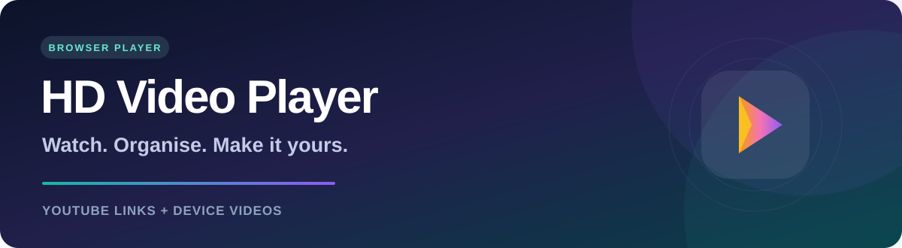
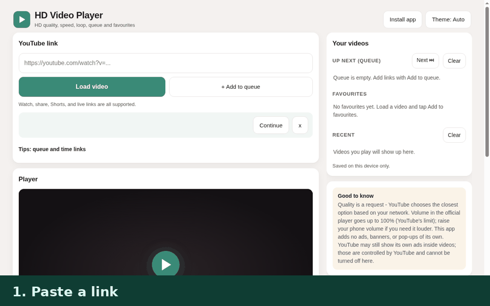
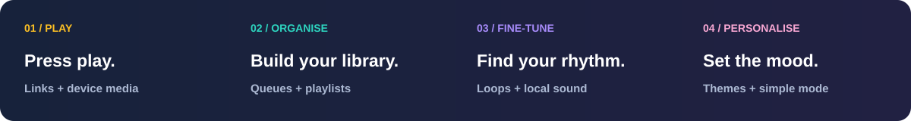
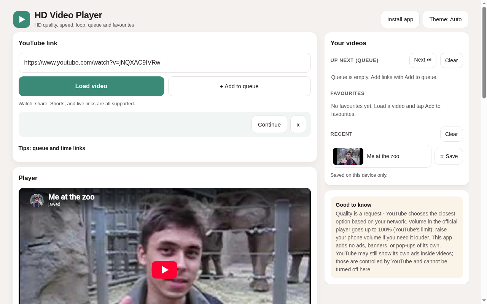

<div align="center">

<a href="https://vp-player.pages.dev/"></a>

[](#main-functions)
[](#main-functions)
[](#main-functions)
[](#main-functions)
[](#main-functions)
[](#main-functions)

# [▶ Open live demo](https://vp-player.pages.dev/)

**YouTube links · Device videos · Your own playback workspace**

[](https://vp-player.pages.dev/)
[](docs/GUIDE.md)

<a href="https://vp-player.pages.dev/"></a>

**↑ Earlier-version recording. For today's interface, open the live demo.**

**English · हिंदी · ગુજરાતી** &nbsp; | &nbsp; **Phone + desktop** &nbsp; | &nbsp; **No app account needed**

</div>

---

## Main functions



| **▶ Watch** | **▦ Organise** |
| :--- | :--- |
| **YouTube embeds + device videos**<br>**Speed · Captions · Timestamp sharing** | **Queue · Playlists · Favourites**<br>**Watch later · History · Backup** |
| **♫ Fine-tune** | **◈ Make it yours** |
| **A-B loops · Dual local subtitles**<br>**Local EQ · Volume boost · Frame capture** | **Glass themes · Simple mode · Shortcuts**<br>**Sleep timers · Notes · Saved moments** |

**Also included:** [**Device-video study tools**](docs/GUIDE.md#detailed-device-video-guides) · [**Supported non-YouTube downloads**](docs/GUIDE.md#what-is-included) · [**Full feature guide**](docs/GUIDE.md)

## A closer look

| **Desktop** | **Phone** |
| :---: | :---: |
|  |  |

**Earlier-version screenshots, not a current feature inventory.**

## Start in seconds

### 1 · Open → 2 · Paste or pick → 3 · Play

**[Launch the app](https://vp-player.pages.dev/)** → **Paste a YouTube link** or choose **Local file** → **Play video**.

**Save your lists?** Use **Export backup**. Libraries and settings stay in this browser, not in a cloud account.

## Know the limits

> **YouTube stays in its official embedded player.** Downloads, audio-only and screen-off YouTube playback are not provided. YouTube controls stream availability and quality.
>
> **Local tools depend on your browser and codecs.** EQ and volume boost apply to device media. Saved-file reopening, PiP and notifications vary by browser.
>
> **Keep a backup.** Clearing browser data can remove saved lists and settings. Downloads from other sites may fail or wait while the free backend wakes up. Only save content you have permission to download.

## Build & contribute

[](index.html)
[](https://vp-player.pages.dev/)
[](server/)

**Run the frontend locally:**

```sh
python3 -m http.server 8000
```

**Open `http://localhost:8000`. Online playback and hosted downloads still need a connection.**

**[Setup, API & deployment](docs/GUIDE.md#architecture)** · **[Contributing](CONTRIBUTING.md)** · **[Security policy](SECURITY.md)** · **[Package guide](PACKAGING.md)**

## License

**Dual-licensed under [MIT](LICENSE-MIT) OR [Apache-2.0](LICENSE-APACHE), at your choice.**

**Copyright © 2026 Bheda Nikhilkumar.**

---

<div align="center">

**Built by Nikhilkumar · Free tools only**

[**Open live demo ↗**](https://vp-player.pages.dev/) · [**Explore the guide ↗**](docs/GUIDE.md)

</div>
