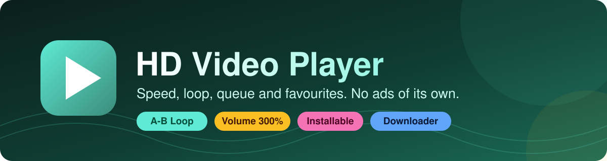

<div align="center">



# HD Video Player

YouTube links, device videos, a personal library and playback tools in one browser app.

### [Open the app](https://vp-player.pages.dev/)

English by default · Hindi · Gujarati · Phone and desktop · Installable PWA

</div>

## Start here

1. Open **https://vp-player.pages.dev/**. Paste a YouTube link in the link box and choose **Play video**, or add it to the queue.
2. For a file on your device, open **Local file** and choose the file. Playback depends on the codecs your browser supports, not just the filename extension.
3. Use the section menu or **Search** to find controls. **Simple mode** reduces the interface. Press **?** for keyboard shortcuts.
4. Save favourites, Watch later items or named playlists in **Your videos**. Use **Export backup** before clearing browser data or moving to another device.
5. To download from a supported non-YouTube site, open **Downloader**, paste its link, fetch its available formats and select the output. Only download content you have permission to save.

No app account is needed. There is no account-based cloud library sync: lists and settings belong to this browser and site origin. Moving from an old app URL requires exporting a backup there and importing it at the new URL.

## What is included

This is a grouped guide, not a promise that every control works for every source or browser.

| Area | Tools |
|---|---|
| YouTube player | Official embedded player, playback speed, captions, queue, shuffle/repeat, quality requests and timestamp links. YouTube controls actual stream availability. |
| Library | Favourites, Watch later, history, Continue watching, named playlists, queue ordering, filters, saved searches, fuzzy search and backup/import tools. |
| Playback planning | A-B loops and named loops, saved moments, notes, sleep timers, break reminders, watch goals and viewing statistics. |
| Sharing | Timestamp links, QR sharing, playlist links and saved-moment/share cards. Local file access is not transferred by sharing a link. |
| Device media | Volume boost up to 300%, equalizer, speed, picture adjustments, fit/zoom/rotate, frame capture and markup, scene-change navigation, chapters and playback cue sheets. |
| Subtitles | Local SRT/VTT upload and timing sync, dual subtitles and subtitle display controls. YouTube captions remain controlled by its embedded player. |
| Device library | A VLC-style Recommended shelf for files previously opened in the app. It does not scan your device storage. Reopening a saved file without choosing it again depends on browser support and file permission. |
| Study tools | Study workspace, notes, saved moments, clip itineraries and cue-sheet planning. An itinerary controls playback; it does not export an edited video. |
| Downloader | Supported non-YouTube sites, format selection, video/audio merge, MP3 quality choices, original audio, trim, available subtitles and a multi-link queue with retry. Site restrictions can prevent downloads. |
| Interface | Glass-style layout, phone and desktop layouts, section search, Simple mode, music mode, themes, designer backgrounds, appearance previews and portable theme files. |
| Accessibility and efficiency | Larger text, high contrast, reduced motion, Low-end mode, data/battery saver controls, keyboard controls and optional alternative input tools. |
| App shell | Installable PWA, supported share/file handlers, offline status and cached app resources. Offline app access does not make online videos available offline. |

### Languages and appearance

- The default interface language is English. The header cycles between English, Hindi and Gujarati and remembers the choice. Translations may be incomplete or imperfect.
- Theme modes: **Auto**, **Day/Night**, **Light**, **Dark** and **Midnight** (OLED-style).
- Background choices: Classic, Sunset, Ocean, Forest, Rose, Lavender, Amber, Mint and Graphite, with accent-colour controls.
- The **Theme fitting room** previews a look for 20 seconds. **Keep this look** saves it; **Revert** cancels it. `.vplook` theme export/import contains appearance choices, not the library or media.

### Limits worth knowing

- The app adds no advertising of its own. YouTube may show its own ads. This is not an ad blocker.
- No YouTube downloading. The downloader rejects YouTube URLs.
- No promise of screen-off, background or audio-only YouTube playback. Use YouTube's own supported options. Local-media lock-screen controls depend on the browser and operating system.
- Volume boost and equalizer tools apply to local/device media, not the YouTube iframe. Picture-in-picture and fullscreen also depend on source and browser support.
- A quality selection is a request, not a guarantee. Some embeds refuse playback, captions or requested rates.
- Device files are not uploaded for ordinary local playback, subtitle display or scene scanning. Download jobs for remote sites are handled by the separate backend.
- Clearing browser data can remove your library and settings. Keep exported backups somewhere safe. A backup is not a copy of your media files.
- PWA installation, file handlers, saved-file reopening, notifications and other browser APIs are not supported equally everywhere. Mobile viewport checks are not real iPhone or Android device tests.
- Free hosting can sleep, throttle or hit service limits. A backend health response does not prove a particular site's download will work.

## Architecture

```text
Browser app: index.html + manifest + service worker
  |-- YouTube links --> official YouTube embedded player
  |-- Device files --> browser media APIs and device-local storage
  `-- Other-site download jobs --> Render / Flask / yt-dlp / ffmpeg

GitHub main --> Cloudflare Pages frontend
server/ --> Render backend deployment
```

| Part | Current setup |
|---|---|
| Frontend | Static HTML, CSS and vanilla JavaScript in `index.html`; no frontend framework or build step required. |
| Primary app | https://vp-player.pages.dev/ on Cloudflare Pages. |
| App metadata and offline shell | `manifest.webmanifest`, `sw.js` and app icons. |
| Backend | `server/app.py`, Flask, yt-dlp and ffmpeg, packaged with `server/Dockerfile`. |
| Backend URL | `https://vp-downloader.onrender.com`. Free-host availability and quotas apply. |
| Persistence | Browser storage for app settings and personal lists; browser-supported storage/permissions for saved device files. Download jobs use temporary backend files. |

### Backend API and guardrails

| Method | Path | Purpose |
|---|---|---|
| GET | `/health` | Backend status, yt-dlp version and ffmpeg availability. |
| POST | `/tasks` | Start an `info` or `download` job. |
| GET | `/tasks/<id>` | Read job progress, result or error. |
| GET | `/files/<id>` | Fetch a completed download. |
| GET | `/playlist` | Playlist metadata/import support. |
| GET | `/chapters` | Chapter lookup support, subject to upstream restrictions. |

The backend code allows CORS from the Cloudflare app and local development on port 8000. It rejects YouTube download URLs and private/local destination addresses at initial URL validation. CORS is not authentication and is not a complete network-security boundary.

Configured limits include three queued/running jobs at once, a three-hour duration check for format-info requests, a 400 MiB downloader size option and temporary job/file cleanup after a 15-minute lifetime. These are code settings, not a guarantee that every upstream service enforces a precise size or duration limit. Do not treat this small free-host service as a hardened multi-user download platform.

## Development and deployment

### Run the frontend locally

```sh
python3 -m http.server 8000
```

Open `http://localhost:8000`. YouTube and backend features still need a network connection. Some APIs require HTTPS or a browser that supports them.

### Run the backend locally

Use the Dockerfile in `server/`:

```sh
docker build -t vp-downloader ./server
docker run --rm -p 10000:10000 vp-downloader
```

The frontend's downloader API URL is configured in `index.html`; it points to the hosted backend by default. Local frontend hosting alone does not switch that URL.

### Deploy

- Frontend: the configured Cloudflare Pages Git integration deploys `main`. Confirm a changed build actually reaches the live app; a successful push alone is not deployment proof.
- Backend: the Render service builds from `server/Dockerfile`. Backend changes need a Render deployment; a frontend-only check cannot verify them.
- Service worker caches can leave an existing tab on an older app. Reload and use the app's offline-repair tools when appropriate. Export a backup before clearing site data.
- An external keep-alive schedule is not stored in this repository. Check its dashboard before relying on a particular ping cadence or overnight sleep window.
- Keep hosting and tools within free tiers. Provider quotas and plans can change.

### Tests

`tests/` contains focused Node regression checks and browser tests. There is no single package-managed test command. Run a selected source regression check with `node tests/<test-name>.test.cjs`; browser tests additionally need their declared dependencies, a compatible Chrome executable and any test media tools. Some older tests describe historical implementations, so inspect a failure before treating it as a current runtime bug.

## Detailed device-video guides

## Retiming a playback cue sheet

Open a device video, open **Playback cue sheet**, then **Retime playback cues**.
This changes playback instructions, not the video file. It does not work on
YouTube embeds.

- **Shift all cues:** enter seconds to move the whole sheet. Use a negative
  value to move it earlier.
- **Align using two points:** match two original times to two desired times.
  The app stretches cue times in that proportion. Speed and volume values
  stay unchanged.
- Jump destinations stay unchanged unless **Also retime jump destinations**
  is selected. Preview shows the old and new cue times and any changed
  jump destination, to hundredth-second precision.
- **Preview timing changes** changes nothing. **Apply timing changes** applies
  the reviewed sheet as one change and disarms cues. It never seeks or plays.
  Any out-of-video result or conflicting pause/jump timestamp rejects the
  entire operation, without clamping or dropping individual cues.
- **Undo last timing change** restores the previous sheet while it is still
  the same device file and no later cue edit has been made. Undo is tab-only
  and does not rewrite a sheet already saved on the device.

Use **Save cues on this device** or **Export cue sheet** after applying changes
if you want to keep them. Opening a new file or reloading never applies timing
changes or arms cues automatically. Existing limits still apply: 40 cues per
sheet, device files only, and no automatic identification of an edited video.
All controls and review labels support English, Hindi and Gujarati.

### Scene change navigator (device videos)

Open a device video, then expand **Scene change navigator** in Local file controls.
- **Scan scene changes** reads at most 120 small frames in a separate muted decoder. It never uploads the file or moves the main playback clock.
- Choose **More changes**, **Balanced changes** or **Only strong changes** to filter the cached scan without decoding again. Tap a thumbnail to seek without starting playback.
- Select scene checkboxes and open **Scenes to clip itinerary** to review up to 40 ranges in the existing itinerary importer. Existing clips are replaced only after explicit confirmation.

These are sampled estimates, not frame-exact edits. Movement or lighting can look like a cut; short scenes between samples can be missed. Sample spacing is shown. Device video only, up to two hours; audio and direct links are not scanned. Results and selections stay in the tab and clear when its video changes or the page reloads. The itinerary is a playback plan, not an exported video.

## Screenshots and demo

The bundled images and demo show earlier app versions. They illustrate the layout but are not a current feature inventory.

| Desktop | Phone |
|---|---|
|  |  |

[Earlier demo recording](assets/3-demo.gif)

---

Built by Nikhilkumar. Free tools only.
